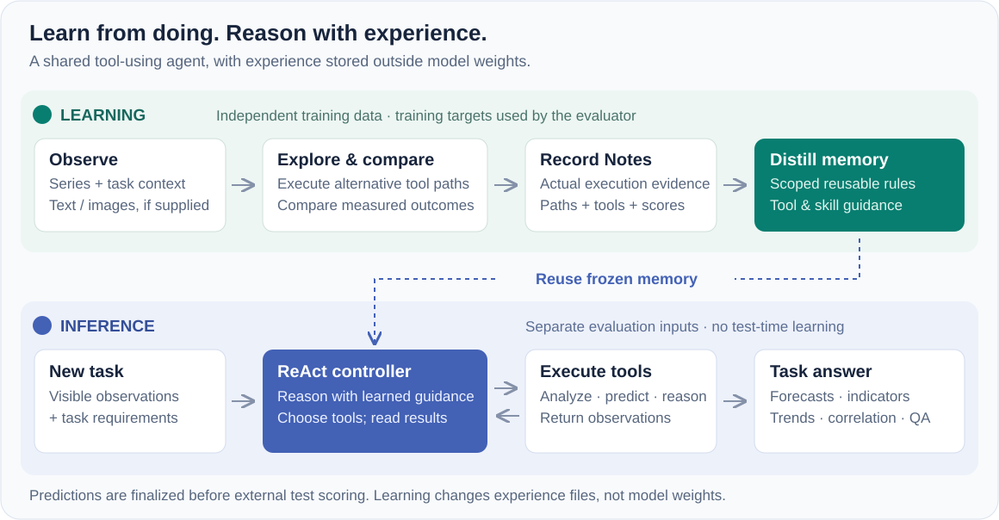

<div align="center">

# TimeClaw

### A Time-Series AI Agent with Exploratory Execution Learning

**NeurIPS 2026 · Official Implementation**

**Explore alternative tool paths. Learn from execution. Reuse experience.**

[](https://neurips.cc/virtual/2026/poster/153295)
[](docs/PROJECT_IDENTITY.md)
[](https://arxiv.org/abs/2605.10038)
[](https://github.com/HankLiu10/TimeClaw/actions/workflows/tests.yml)
[](#quick-start)
[](LICENSE)

[**NeurIPS paper**](https://neurips.cc/virtual/2026/poster/153295) · [**OpenReview**](https://openreview.net/forum?id=MK0e2fxdTl) · [**Quick start**](#quick-start) · [**Tasks**](#tasks-and-evaluation) · [**Documentation**](#documentation)

Hangchen Liu · Dongyuan Li · Jiewen Deng · Weiwei Ye · Yoshihide Sekimoto · Renhe Jiang

</div>

> **Official, author-maintained code** for the **NeurIPS 2026** paper
> [*TimeClaw: A Time-Series AI Agent with Exploratory Execution Learning*](https://neurips.cc/virtual/2026/poster/153295).
> The [first arXiv preprint](https://arxiv.org/abs/2605.10038v1) was submitted on **May 11, 2026**.
> The canonical repository is **[HankLiu10/TimeClaw](https://github.com/HankLiu10/TimeClaw)**.

TimeClaw combines **time-series tools, language-model reasoning and reusable
experience**. Its ReAct
controller repeatedly chooses a tool, executes it and reads the observation.
During learning, it explores alternative paths, compares their outcomes and
distills experience into hierarchical memory. At inference time, that frozen
memory guides subsequent decisions. **Learning updates experience files, not
model weights.**

<p align="center">
  
</p>

| What makes TimeClaw useful? | How it works |
|---|---|
| **Execution-grounded learning** | Task-aware tool dropout varies tool availability to encourage alternative paths; learning retains their real execution outcomes. |
| **Reusable hierarchical memory** | Turn per-example Notes into scoped rules and tool/skill guidance, then reuse them without changing model weights. |
| **Multimodal time-series reasoning** | Combine numerical observations with task-provided text and supported image inputs through a shared tool-using agent. |
| **A shared evaluation protocol** | Use explicit task definitions, common scorers and separate learning/evaluation inputs across finance and weather. |

For example, a financial task can combine a price series with news, use a
forecasting tool and return a trend decision. A weather task can ask for future
temperatures, extrema or a multiple-choice answer. The controller chooses the
execution path; these examples are not fixed pipelines.

## Quick start

The verified core environment is **Linux with Python 3.10**. Statistical tools
are included; neural forecasting tools require their own dependencies and
weights. See [model setup](docs/MODELS.md).

### 1 · Install

```bash
git clone https://github.com/HankLiu10/TimeClaw.git
cd TimeClaw
python3.10 -m venv .venv
source .venv/bin/activate
python -m pip install -r requirements-py310.lock
python -m pip install -e '.[dev]'
python -m pip check
python scripts/setup_mtbench.py

# Check the tool catalog without model credentials or weights.
timeclaw tools --list
```

The setup helper installs a pinned revision of the external MTBench prompt and
metric code. **It does not download datasets or model weights.**

### 2 · Configure and prepare data

```bash
cp configs/default.yaml configs/local.yaml
export TIMECLAW_CONFIG="$PWD/configs/local.yaml"
export OPENAI_API_KEY='YOUR_OWN_KEY'

# Inspect, then download the pinned official evaluation inputs.
python scripts/download_mtbench.py --list
python scripts/download_mtbench.py
```

Set your provider, model and any optional model services in
`configs/local.yaml`. The supplied profile uses `gpt-6.1-sol` with low reasoning
effort; it is a software default, not a claim about the paper's historical model
configuration. Provider calls may incur charges. `.env` files are not loaded
automatically.

> [!IMPORTANT]
> **Learning needs independent training data.** Place separately collected records
> under `data_preparation/independent/splits/<dataset>/`, following the
> [data schema](docs/DATA.md). A complete public training-corpus download is not
> currently supplied. Official evaluation data is never substituted for missing
> training data. Inference from an empty workspace runs untrained native ReAct;
> it does not represent the learned agent.

The default config declares all eight evaluation pools and explicitly loads the
audited observation-time metadata attachment. For a smaller download and
experiment, set `benchmark.evaluation_datasets` explicitly; see the
[data and configuration guide](docs/RUN_GUIDE.md#data-and-configuration).

### 3 · Learn experience, then run frozen inference

After preparing independent weather training records and the evaluation inputs:

```bash
# Explore independent training examples and finalize their memory.
python -m timeclaw.benchmark.run_learning --train \
  --dataset weather_aligned_short --task trend_past --max-samples 2 \
  --concurrency 1 --per-task-concurrency 1

# Evaluate with the same workspace's frozen memory.
python scripts/run_timeclaw_mtbench_inference.py \
  --config configs/local.yaml --task-set paper30_original \
  --task weather_trend_past_short --samples-per-task 2 \
  --per-task-concurrency 1 --llm-max-inflight-requests 1 \
  --output-root results/main --run-id weather_past_short
```

These two examples are a small workflow check, not a full benchmark. The task
preset is **`paper30_original`** by default. Keep the same configuration and
workspace across learning and inference. Inference checks the frozen learning
lineage and does not learn from test answers.

See the [full run guide](docs/RUN_GUIDE.md) for sample selection, workspaces,
retries, resume behavior and the direct-LLM baseline.

<details>
<summary><strong>What is stored in memory?</strong></summary>

A **Note** records one training experience: its actual execution path and measured
outcome. **MEMORY** stores rules distilled from Notes; TOOLS/SKILLS guidance is
derived from those rules. Ten new Notes in a scope trigger batch distillation;
training finalization processes any remainder. The separate thirty-Note counter
controls history snapshots.

Exploration seeks at least two valid, executed and scored branches. If multiple
branches were attempted but the budget ends with only one valid scored path,
TimeClaw can retain a **single-execution Note**. It records what happened, without
claiming a comparative winner. For example, a measured forecast MAE can be stored,
but cannot establish that its tool outperformed a branch that failed. Zero-candidate
or unscored attempts cannot create such a Note. These Notes cannot support relative
tool-selection rules or winner-frequency statistics.

</details>

## Tasks and evaluation

The default **`paper30_original`** preset matches the paper's main-table inventory:
**17 tasks across finance and weather, reported through 30 metric cells**.
A metric cell is one score for one task; a task can have several metrics.

| Domain | Task families | Settings | Tasks |
|---|---|---|---:|
| Finance | Forecasting, MACD prediction, trend classification, news–price correlation, multiple-choice QA | Short and long | 10 |
| Weather | Forecasting and multiple-choice QA | Short and long | 4 |
| Weather | Indicator prediction, future trend and past trend | Short | 3 |
| **Total** | | | **17** |

For instance, the weather indicator task predicts the maximum temperature,
minimum temperature and their difference, each scored by MSE and MAE: **one task,
six metric cells**. The [complete task table](docs/PAPER_TASKS.md) lists every key,
dataset and metric.

The direct-LLM baseline receives the same visible task prompt and uses the same
scorer. Both methods retain raw predictions, failures and exclusion counts, with
upstream-filtered and all-valid summaries. Compare the same frozen sample cohort;
read the [scoring protocol](docs/SCORING.md) before interpreting results.

<details>
<summary><strong>Release scope and reproducibility</strong></summary>

- This repository contains repaired **main-experiment source**, setup helpers and
  regression tests. Raw datasets, old training products, learned memory, model
  weights, ablations and case-study runners are not included.
- Source-package validation passed **1,223 tests**, with four optional-package
  skips. These software checks do not establish reproduction of historical paper
  scores or certify every optional neural-model environment. Current CI is linked
  at the top of this page.
- The supplied source-time profile preserves the original series, news and labels
  while supplying audited observation-time and weather-station metadata. See the
  [evidence protocol](docs/OBSERVATION_TIME_EVIDENCE.md).
- `timeclaw18` is an explicit **18-task / 26-cell extension**, distinct from the
  paper preset. It omits weather indicators and adds long future/past weather
  trends. Changing presets requires a fresh workspace and output; existing runs
  are not relabeled.
- Independent-corpus availability and historical-result provenance are documented
  in [data readiness](docs/DATA_READINESS.md) and
  [paper alignment](docs/PAPER_ALIGNMENT.md).

</details>

<details>
<summary><strong>Which TimeClaw project is this?</strong></summary>

This is the official implementation of the NeurIPS 2026 paper
*TimeClaw: A Time-Series AI Agent with Exploratory Execution Learning*, first
released as arXiv:2605.10038. It is maintained by the paper's authors and is
distinct from independently developed projects sharing the name TimeClaw.
Use the full paper title and canonical repository URL when linking or citing
this work. See [project identity](docs/PROJECT_IDENTITY.md) for the publication
links and citation details.

</details>

## Documentation

| I want to… | Start here |
|---|---|
| Install, configure and run an experiment | [Full run guide](docs/RUN_GUIDE.md) |
| Understand exploration, memory and inference | [Architecture](docs/ARCHITECTURE.md) |
| Find task keys, datasets and metrics | [Paper task inventory](docs/PAPER_TASKS.md) |
| Prepare independent training records | [Data schema](docs/DATA.md) · [Data boundaries](docs/DATA_BOUNDARIES.md) |
| Set up forecasting models and weights | [Model setup](docs/MODELS.md) |
| Understand evaluation and known scoring differences | [Scoring protocol](docs/SCORING.md) |
| Check validation evidence and reproduction limits | [Release validation](docs/RELEASE_STATUS.md) · [Paper alignment](docs/PAPER_ALIGNMENT.md) |
| Identify the official paper and implementation | [Project identity](docs/PROJECT_IDENTITY.md) · [NeurIPS 2026](https://neurips.cc/virtual/2026/poster/153295) |
| Report a bug or contribute | [Contributing](CONTRIBUTING.md) · [Issues](https://github.com/HankLiu10/TimeClaw/issues) |

## Citation

If TimeClaw is useful for your research, please cite our **NeurIPS 2026** paper:

```bibtex
@inproceedings{liu2026timeclaw,
  title={TimeClaw: A Time-Series AI Agent with Exploratory Execution Learning},
  author={Liu, Hangchen and Li, Dongyuan and Deng, Jiewen and Ye, Weiwei and Sekimoto, Yoshihide and Jiang, Renhe},
  booktitle={Advances in Neural Information Processing Systems},
  year={2026},
  url={https://neurips.cc/virtual/2026/poster/153295}
}
```

The author order follows the maintainer's correction, with Renhe Jiang last;
the public arXiv v1 snapshot may retain the earlier order. Machine-readable
metadata is available in [CITATION.cff](CITATION.cff).
The [arXiv version](https://arxiv.org/abs/2605.10038) remains available as a
preprint. Proceedings volume, pages and DOI are omitted until verified.

<div align="center">

**[NeurIPS 2026 paper](https://neurips.cc/virtual/2026/poster/153295) · [Explore the code](timeclaw) · [Get started](#quick-start)**

MIT-licensed project code · [License](LICENSE) · [Third-party notices](THIRD_PARTY_NOTICES.txt)

</div>
